# XX餐饮集团管理架构现状与同类集团变革案例

本材料包含XX餐饮集团管理架构的现状描述，以及两个可比集团（2+n型业务集团、关联多元化集团）的组织变革案例，说明其变革前后的管控层次变化与变化原因。材料只陈述事实与案例，不含针对XX餐饮的改进建议。

## 总体说明与组织现状诊断

### 1.3 组织问题的变革迫切性

#### 对XX餐饮股份公司与酒管公司的战略达成已产生显著危害

**XX餐饮集团的业务版图**（浅灰：既有经营产业　深灰：未来产业延伸）

- **酒店业务**
  - XX餐饮饭店分公司
  - 南京XX餐饮饭店有限公司
  - 南京XX餐饮酒店管理有限公司
  - 湖X饭店
  - 天X湖酒店
  - 南京XX餐饮大厦有限公司
  - 自有酒店经营；酒店管理输出
- **养老业务**
  - 江苏XX餐饮XX老年养怡股份有限公司
  - 自有养老经营；养老服务输出
- **多元业务**
  - 江苏XX开发建设有限公司
  - 南京XX餐饮置业发展有限公司
  - 江苏XX餐饮贸易有限公司
  - 江苏XX餐饮旅游发展有限公司
  - XX餐饮XX物业服务有限公司
  - 江苏XX糖酒食品有限公司
  - 旅游、糖酒/食品、地产、物业
  - 物贸、电商、产业园规划/建设/经营、金融
  - 电商、以及酒店生态链上的更多孵化产业

未来5-10年，XX餐饮集团的战略达成至少包括以下3点：
1. 以双支柱产业(酒店+养老)奠定集团可持续发展的基础
2. 围绕旅游/酒店/生活的生态链，以更多孵化成功的业务，在价值上与战略上对酒店产业形成有益补充
3. 将XX餐饮逐步打造为品牌分层&全国布局的连锁酒店产业领先者

前述两个根本性的组织问题，对股份公司/酒管公司的战略达成有直接的、显著的危害

#### 要解决《现状报告》中的连锁酒店产业主要问题，必先突破组织问题

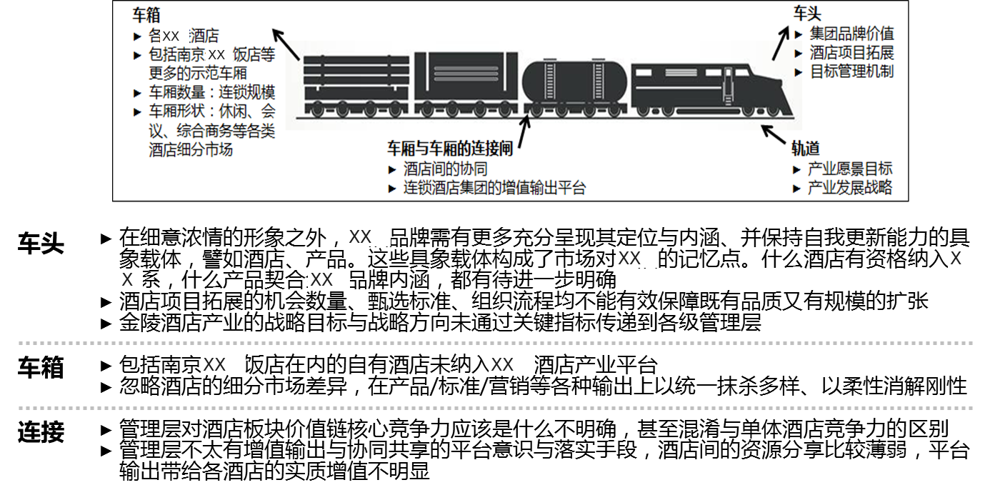

**图示：XX餐饮酒店产业"火车"隐喻模型**

图形结构（火车隐喻，从左到右：车箱→车厢连接闸→车头，下方为轨道）：
- **车箱（左侧车厢部分）**
  - 各XX餐饮酒店
  - 包括南京XX餐饮饭店等更多的示范车厢
  - 车厢数量：连锁规模
  - 车厢形状：休闲、会议、综合商务等各类酒店细分市场
- **车厢与车厢的连接闸（车厢之间，箭头指向连接处）**
  - 酒店间的协同
  - 连锁酒店集团的增值输出平台
- **车头（右侧车头部分）**
  - 集团品牌价值
  - 酒店项目拓展
  - 目标管理机制
- **轨道（车头下方，箭头指向轨道）**
  - 产业愿景目标
  - 产业发展战略

下方文字说明（按板块分类）：
- **车头**
  - 在细意浓情的形象之外，XX餐饮品牌需有更多充分呈现其定位与内涵、并保持自我更新能力的具象载体，譬如酒店、产品。这些具象载体构成了市场对XX餐饮的记忆点。什么酒店有资格纳入XX餐饮系，什么产品契合XX餐饮品牌内涵，都有待进一步明确
  - 酒店项目拓展的机会数量、甄选标准、组织流程均不能有效保障既有品质又有规模的扩张
  - XX餐饮酒店产业的战略目标与战略方向未通过关键指标传递到各级管理层
- **车箱**
  - 包括南京XX餐饮饭店在内的自有酒店未纳入XX餐饮酒店产业平台
  - 忽略酒店的细分市场差异，在产品/标准/营销等各种输出上以统一抹杀多样、以柔性消解刚性
- **连接**
  - 管理层对酒店板块价值链核心竞争力应该是什么不明确，甚至混淆与单体酒店竞争力的区别
  - 管理层不太有增值输出与协同共享的平台意识与落实手段，酒店间的资源分享比较薄弱，平台输出带给各酒店的实质增值不明显

在《现状报告》中谈到的以下问题，其解决首先要解决组织问题：
- 项目拓展缺少主动性、不接地气、与品牌发展战略脱节的问题
- 战略目标与价值目标不能传递到各级管理层的问题
- 自有酒店未纳入XX餐饮酒店产业平台的问题
- 酒店管理平台的统一输出忽略各细分市场在产品/标准/营销上差异性的问题

这些组织问题需通过新的委员会/工作组/部门/岗位、新的职能/职责、以及相应的人员配置落实解决

### 1.4 组织优化必须尊重普遍规律

XX餐饮的组织变革并非独创性变革。全球领先酒店集团在组织设置上的共性规律应予遵循，无论当前/近期/中远期架构，均不要因个性而背离

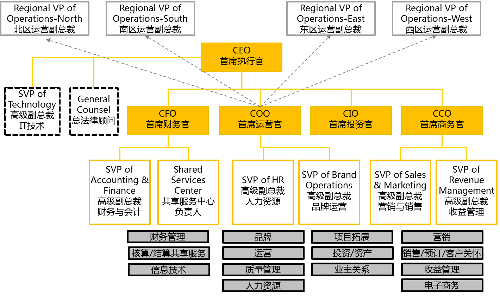

图示转写（A类集团组织架构）：

- CEO 首席执行官
  - （实线，CEO 直属，虚线框）SVP of Technology 高级副总裁 IT技术
  - （实线，CEO 直属，虚线框）General Counsel 总法律顾问
  - CFO 首席财务官
    - SVP of Accounting & Finance 高级副总裁 财务与会计
    - Shared Services Center 共享服务中心负责人
  - COO 首席运营官
    - SVP of HR 高级副总裁 人力资源
    - SVP of Brand Operations 高级副总裁 品牌运营
    - （灰色虚线箭头，自 COO 指向）Regional VP of Operations-North 北区运营副总裁、Regional VP of Operations-South 南区运营副总裁、Regional VP of Operations-East 东区运营副总裁、Regional VP of Operations-West 西区运营副总裁
  - CIO 首席投资官（下方无 SVP 框）
  - CCO 首席商务官
    - SVP of Sales & Marketing 高级副总裁 营销与销售
    - SVP of Revenue Management 高级副总裁 收益管理

图底部灰色职能框按四位 C*O 分列对齐：

| CFO 列 | COO 列 | CIO 列 | CCO 列 |
| --- | --- | --- | --- |
| 财务管理 | 品牌 | 项目拓展 | 营销 |
| 核算/结算共享服务 | 运营 | 投资/资产 | 销售/预订/客户关怀 |
| 信息技术 | 质量管理 | 业主关系 | 收益管理 |
|  | 人力资源 |  | 电子商务 |

全球领先酒店集团的共性规律不只是借鉴表面，更主要是借鉴内在原理(即管理科学的基本原理)，例如

- **表面**：设若干C*O，每个C*O分管职能相近的若干部门——例如拓展/投资/资产/业主关系等部门由CIO统管
  **原理**：增强部门间协同性、有效的管理跨度、保持高管间权力平衡
- **表面**：设核算结算/信息/采购等共享服务中心
  **原理**：在规模扩张的同时保持标准化体系落实、向心力、降低中后台运作成本

尽管每个企业都有自身历史原因形成的特殊个性，但整体框架首先讲共性；近期目标方案要尽量靠拢这些共性做法，当前落地实施方案也不能违背这些普遍规律

集团型企业的分层合理定位各有授权、垂直管控打通的共性规律应予遵循，无论当前/近期/中远期架构，均不要因个性而背离

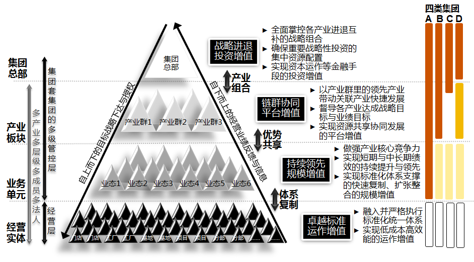

图示转写（多级管控金字塔与四类集团）：

左侧层级标签（自上而下）：集团总部、产业板块、业务单元、经营实体。左侧竖向标注：「集团套集团的多级管控层」（跨集团总部至业务单元）、「多产业多层级多成员多法人」（跨产业板块至经营实体）、「经营层」（经营实体段）。

金字塔自上而下四层：
- 塔尖：集团总部
- 第二层：产业群1、产业群2、产业群3
- 第三层：业态1至业态6
- 底层：门店、门店、工厂、工厂、基地、基地、项目、项目、分部、分部、……

金字塔左斜边：自上而下的目标战略下达与授权；右斜边：自下而上的经营业绩反馈与信息。层间双向箭头：塔尖与第二层之间「产业组合」，第二与第三层之间「优势共享」，第三层与底层之间「体系复制」。

右侧与各层对应的增值定位：
1. **战略进退投资增值**：全面掌控各产业进退互补的战略组合；确保重要战略性投资的集中资源配置；实现资本运作等金融手段的投资增值
2. **链群协同平台增值**：以产业群里的领先产业带动关联产业快捷发展；督导各产业达成战略目标与业绩目标；实现资源共享协同发展的平台增值
3. **持续领先规模增值**：做强产业核心竞争力；实现短期与中长期绩效的持续提升与领先；实现标准化体系支撑的快速复制、扩张整合的规模增值
4. **卓越标准运作增值**：融入并严格执行标准化统一体系；实现低成本高效能的运作增值

最右侧「四类集团」柱状区（A、B、C、D 四列，纵向四段与金字塔四层对应，图中无图例）：

| 段（对应层） | A | B | C | D |
| --- | --- | --- | --- | --- |
| 集团总部 | 深橙色 | 深橙色 | 深橙色 | 深橙色 |
| 产业板块 | 深橙色 | 深橙色 | 上半段深橙色、下半段空白 | 金黄色 |
| 业务单元 | 深橙色 | 浅黄色 | 浅黄色 | 浅黄色 |
| 经营实体 | 空心框 | 空心框 | 空心框 | 空心框 |

集团企业在组织顶层设计上最重要的合理性，是管控分层定位各有授权、垂直管控打通、实现组织扁平化

- 分层定位垂直打通，不是把整个集团扁平成一个决策层次、其他组织层次都只做执行；而是形成一元多核的架构
- **一元**：对酒店产业、养老产业、多元投资与孵化产业的资源投入/目标产出/投资增值的决策与控制，不属于产业自身，必需由高于产业的集团/股份管控层负责
- **多核**：根据产业数量、企业数量、产业/企业协同性，使每个组织层次都能保证适当的管理深度与管理跨度，使每项决策都由最适合的组织层次去做，使投资管控、产业运营管控、企业经营管理各得其所各司其职

## 集团管理架构与公司治理

### 2.1 现状：集团管理架构完全依循法人架构

XX餐饮集团的组织架构有四层，均为设职能部室的实体组织。组织架构中的所有管理关系均依循法人架构中的股权关系。

[图示] 集团管理架构（依循法人股权关系）：
- 江苏省国资委
  - 100% → 南京XX餐饮饭店集团有限公司
    - **下设职能部室**：资产经营部、党委办公室、信息管理部、纪委监察室、综合财务部、行政办公室、人力资源部、工会、企业管理部、基建工程档案馆、工程管理部、安检会、审计部、招采办
    - 39.40% → XX餐饮饭店股份有限公司
      - **治理架构**：股东大会、董事会、监事会、专业委员会、总经理团队
      - **下设部门**：证券事业部、XX餐饮饭店分公司、招商管理部、食品研发中心、投资发展部、总经理办公室、人力资源部、写字楼租赁部、财务部、审计部
      - 63.87% → 下属公司：
        - 江苏XX餐饮旅游发展有限公司
        - XX餐饮XX物业服务有限公司
        - 江苏XX餐饮贸易有限公司
        - 南京XX餐饮酒店管理有限公司
        - 南京新XX餐饮饭店有限公司
        - 南京XX餐饮置业发展有限公司
          - 江苏XX糖糖酒食品有限公司
          - 各委托管理的连锁酒店
    - 江苏XX开发建设有限公司
    - 江苏XX餐饮XX老年养怡股份有限公司
    - 南京XX餐饮大厦有限公司

来源：XX餐饮饭店官网+集团本部花名册

### 2.3 组织架构不受限于股权架构

2.3 组织架构不受限于股权架构——酒店业务的重要性与成熟度，已到可必须尽快BU化管理的时候。BU化管理的本质，是做实BU这一产业经营管控层

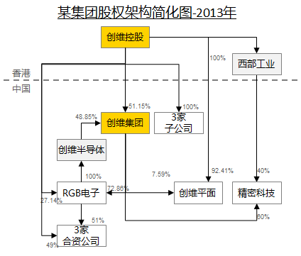

图示转写（某集团股权架构简化图-2013年）：

图中以灰色虚线分为上方「香港」与下方「中国」两个区域。箭头由持股方指向被持股方：

| 持股方 | 被持股方 | 图中标注 |
| --- | --- | --- |
| 创维控股 | 西部工业 | 100% |
| 创维控股 | 创维集团 | 51.15% |
| 创维半导体 | 创维集团 | 48.85% |
| 创维控股 | 3家子公司 | 100% |
| 创维控股 | RGB电子 | 27.14% |
| 创维控股 | 3家合资公司 | 49% |
| 创维控股 | 创维平面 | 92.41% |
| RGB电子 | 创维半导体 | 100% |
| RGB电子 | 3家合资公司 | 51% |
| 西部工业 | 精密科技 | 40% |
| 创维集团 | 精密科技 | 标注数字首位不清晰，读作 80% 或 60% |

RGB电子与创维平面之间为一条双向箭头，标注 72.86%（靠近 RGB电子一端）与 7.59%；图中箭头本身未区分这两个比例各属哪一方向。

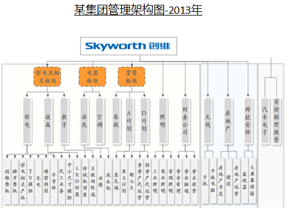

图示转写（某集团管理架构图-2013年）：

- Skyworth 创维
  - 彩电及相关板块
    - 彩电：创维整机、酷开整机、彩电相关产品、TV模组、光电、精密科技、半导体
    - 液晶：代工业务、中小尺寸模组、LED封装
    - 数字：传统机顶盒、互联网终端
  - 电器板块
    - 冰洗：冰箱、洗衣机
    - 空调
  - 零售板块
    - 巷战
    - A计划：惠民城、星火计划
    - D计划：新七天、重资产代运营、轻资产代运营
  - 照明：工业照明、商业照明、景观照明
  - 财务公司：资金管理、资金融通、资本投资
  - 无线：手机、平板电脑
  - 房地产：房地产开发、建设、房地产运营
  - 群欣安防：监视器、大屏幕拼接
  - 汽车电子
  - 非控制型投资

图中三个板块为橙色虚线框；照明、财务公司与三个板块同级；无线、房地产、群欣安防位于浅蓝底区域；汽车电子、非控制型投资位于浅灰底区域。

**由图例见：**
- 该集团的股权架构与管理架构完全无关
- 集团规模越大、投资关系越复杂、产业与地域跨度越多元，股权架构与管理架构越不可能一致
- 并非每个股权架构节点均设实体、并承担管理职能

设计股权架构需考虑的要素是：如何体现出资各方的适当影响力；如何利用好税收惠利与投资惠利政策；如何防御来自资本市场的股权风险——但这些完全不是设计组织架构的考虑要素

XX餐饮的管理关系依循股权关系，因此酒店业务在股权上分属三方、在管理上亦因此分属三方：酒店管理公司负责非自有酒店，股份公司负责南京XX餐饮饭店/新XX餐饮饭店/XX湖酒店，集团负责XX餐饮大厦/湖滨酒店。因此导致的诸多问题，在《现状报告》中已有详述

BU化管理的本质，是以BU作为某一产业的载体，由其负责：制定产业竞争策略、塑造产业核心能力、将产业目标分解到各经营单位、对经营单位的管控。因此，也可以说，BU化管理的本质就是将BU做实，使其承担产业发展的重任

酒店业务是XX餐饮既有的战略/价值/品牌支柱，前景明确，成熟度高于其他业务。在连锁业务发展近十年后，提出酒店业务的BU化管理，时机早已成熟，更无需拘泥于股权关系。未来，其他产业(如：养老、物业)达到一定成熟度时，若存在类似情况，可同样采用BU化管理模式

### 2.6 组织变革案例借鉴：2+n型业务的集团

**变革前**：集团年收入300亿，电业务有20年，铝业务5年前开始扩张，规模已超过电业务，化工作为孵化业务刚启动布局，产业间中弱关联（工程/采购/产业园管理）。

下图是2014年调整后的组织架构——
在调整前，该集团总部设2个事业部（有色金属、化工），另有1个企管公司（绿色能源）。2个事业部属虚拟BU，各有1名专职负责人与一个小工作组，共用总部职能部门。企管公司属实体BU，配设若干部门。调整前的总部职能部门包括：总裁办公室、经营财务部、人力资源部、工程技术部、运行管理部、物资采购部。调整前的总部职能部门，70%用于支撑有色金属事业部的工作。

#### 组织架构示意（2014年调整后）

- **Level-1**：集团总部
  - 总裁办公室
  - 审计监察部
  - 战略投资部
  - 财务管理部
  - 风险管理部
  - 人力资源部
  - 工程管理部
  - 采购管理部
  - 法律事务所
  - 经营贸易公司
  - 共享服务中心
  - 流程与系统创新部
  - 化工事业部

- **Level-2**：
  - 有色金属(铝)企管公司
    - 战略规划部
    - 经营财务部
    - 人力资源部
    - 综合办公室
    - 工程管理部
    - 物资采购部
    - 技术研发部
    - 生产运行部
    - 流程与系统创新部
  - 绿色能源(电)企管公司
    - 战略投资部
    - 经营财务部
    - 人力资源部
    - 综合办公室
    - 工程管理部
    - 物资采购部
    - 技术研发部
    - 生产运行部
    - 流程与系统创新部

- **Level-3**：
  - 隶属有色金属(铝)企管公司：华东铝业、开曼铝业
  - 隶属绿色能源(电)企管公司：余杭电厂、芜湖电厂
  - 隶属化工事业部：锦盛化工

**主要变化**：从一层管控变为两层管控、夯实三级管理架构、集团总部转变为战略管控型总部。
**变化原因**：新业务孵化。

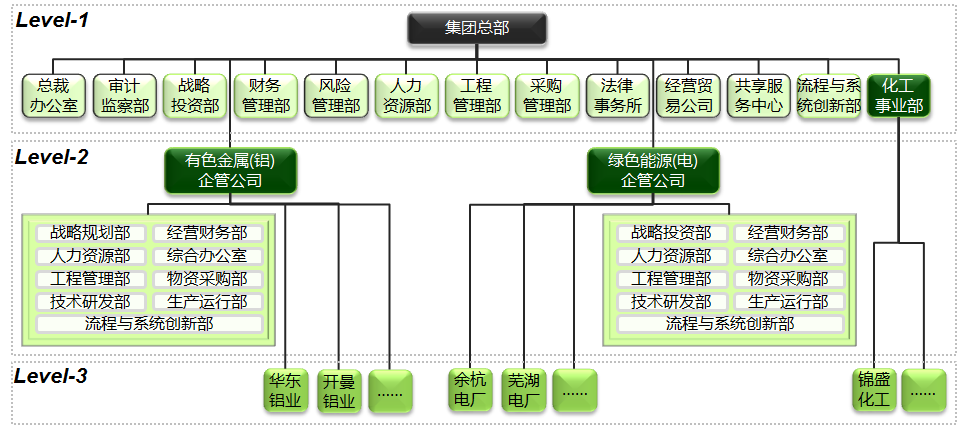

图示转写（2014年调整后三级架构）：

- Level-1：集团总部
  - 总部部门：总裁办公室、审计监察部、战略投资部、财务管理部、风险管理部、人力资源部、工程管理部、采购管理部、法律事务所、经营贸易公司、共享服务中心、流程与系统创新部
  - 化工事业部（竖线直达 Level-3）
- Level-2（由集团总部总线直接下挂）
  - 有色金属(铝)企管公司：战略规划部、经营财务部、人力资源部、综合办公室、工程管理部、物资采购部、技术研发部、生产运行部、流程与系统创新部
  - 绿色能源(电)企管公司：战略投资部、经营财务部、人力资源部、综合办公室、工程管理部、物资采购部、技术研发部、生产运行部、流程与系统创新部
- Level-3
  - 有色金属下：华东铝业、开曼铝业、……
  - 绿色能源下：余杭电厂、芜湖电厂、……
  - 化工事业部下：锦盛化工、……

#### 主要改变
- 实体BU从1变成2：有色金属从原来的虚拟BU变为实体BU
- 集团-BU-工厂三级架构夯实
- 集团-BU两层管控模式夯实
- 集团总部将原来配设的产业运营管控类职能(采购、研发、生产运行、工程)下放两个实体BU，但工程/采购保持总部垂直管控
- 集团总部增加了战略管控型总部应强化的职能：战略投资、稽查风控、流程与系统创新(IT)、共享服务(财务与人力资源共享)

#### 变化原因
- 有色金属已进入规模化发展，集团准备启动孵化第三个产业的大布局。只有明确两层管控的治理模式，才能既释放有色金属的活力，又促使集团总部的工作重心转到战略投资与战略管控上
- 变化的另一背景是，该民企集团进入II代接班期。调整前，总裁(职业经理人)直管集团总部所有部门，同时担任绿色能源企管公司董事长兼总裁
- 在新的组织架构里，总裁直管集团总部原设部门、不直管新设部门；II代负责共享服务中心与战略投资部。总裁仍兼任绿色能源企管公司董事长；原有色金属BU负责人升任有色金属企管公司负责人。新的三点平衡格局(创始人、总裁、有色金属BU负责人)为II代接班形成良好铺垫

### 2.6 组织变革案例借鉴：关联多元化集团

**变革前**：集团年收入500亿，彩电与数字业务均列国内前两名并已国际化，彩电占60%，数字+白电占25%，10多种业务不分大小均设为BU，均由集团总部直管。

下图是2015年调整前的组织架构——

- 在调整前，该集团设16个实体BU，各BU规模/经营周期/盈利能力有显著差别，但都作为集团总部直管的BU。
- 出于扁平化考虑，集团长期保持总部-BU-企业三级管理架构，但因管控范围大、管控深度难保证、事务繁杂到处救火疲于奔命，集团总裁与总部分管部门（财务经营部）深感其苦。
  - 2010年时，集团董事局几位领导分别兼任BU董事长，同时配设委员会，实行2年没有成效。
  - 2012年时，集团按产业前景（未考虑BU经营情况）将BU分为三个梯队，分设专职领导；由于三个梯队下的BU/企业实力强弱悬殊，所以分管领导迟迟定不下来，最终停留于概念，未触动组织变化。

[图示] 变革前组织架构（16个实体BU，均由集团总部直管）：

- 财务公司、群欣安防、汽车电子、非控制型投资
- 第一梯队：创维整机、酷开整机、彩电相关产品、TV模组、精密科技、代工业务、中小尺寸模组、LED封装、传统机顶盒、互联网终端、星火计划、重资产代运营、轻资产代运营、工业照明、商业照明、景观照明、资金管理、资金融通、资本投资
- 第二梯队：平板电脑、房地产开发、房地产运营、大屏幕拼接
- 第三梯队：（与财务公司、群欣安防、汽车电子、非控制型投资同栏对应）

**主要变化**：将16个产业分类为『三圈六型』，将9个存续产业整合进投资BU，区分不同『型』产业的资源投入目标产出管控，实现各产业有差别有聚焦的发展。

[图示] 三圈六型分类模型：

- 圈一：初始型（创投孵化）、存续型（规模补充）
- 圈二：巩固型（价值稳定）、培养型（增长储备）
- 圈三：核心型（双重核心）、增量型（战略支柱）
- 左侧转化方向标签（自上而下）：退出、存续型、巩固型，各层级间标注"负向转化"
- 右侧转化方向标签（自上而下）：培养型、增量型、核心型，各层级间标注"正向转化"

[图示] 组织形式与产业类型对应关系：

- 1个利润中心：金融（初始）
- 1个投资BU：9个存续型产业整合进投资BU
- 2个战略发展BU：内容（培养）、群欣安防（巩固）
- 3个事业部：彩电（核心）、数字（核心）、白电（增量）

- 对16个产业进行战略价值评估，分类为6型。
- 组织形式上则设为4类：3个事业部、2个战略发展BU、1个利润中心、1个投资BU。集团直管对象因此从16个减少至7个。
- 不同类型有不同管控深度、不同目标考核方向、不同资源配置优先度。每年小评一次，三年大评一次，保持合理进退。
- 解决了多年来的3个问题：
  1. 总部管理跨度过大后管不深，许多产业发展与产业竞争的深度决策做也不是、不做也不是；
  2. 多元业务有聚焦、有节奏、有差别的发展，资源投入与目标管理不再一刀切；
  3. 多元业务的可进可退、动态转化。

**主要变化**：增设内销平台、海外B2B平台、研发中心解决5个主要BU间的业务协同问题；BU内的协同由BU决策层自行解决。

[图示] 变革后组织架构：

- 主要BU（集团总部直管）：
  - 彩电事业部
  - 数字事业部
  - 白电事业部
  - 酷开
  - 群欣安防
  - 财务公司
  - 融资租赁公司
  - 战略投资业务部（下设 D计划、巷战、照明、无线、房地产、汽车电子）
- 业务协同平台与总部职能：
  - 研发中心（待设）
  - 内销平台
    - 彩电
    - 白电
  - 海外B2B平台（虚拟）
    - 彩电
    - 数字
    - 冰洗
    - 空调
  - 总部职能部门
    - 投资发展部
    - 战略财务部
    - 人力资源部
    - 品牌管理部
    - 总裁办公室
    - 风险审计部
  - IT中心

- 液晶分拆，各进入彩电与数字。
- 冰洗与空调仍是BU，在白电事业部下，由冰洗总经理兼任白电事业部负责人。
- 财务公司与租赁公司均设立不满2年，两年内采取赛马机制。
- 战略投资业务部负责另9个产业的资产与投资管理、重组、出售、引进投资人等，亦负责新的投资方向。

- 原先的委员会模式在解决协同问题上乏力。
- 由于彩电与白电间在渠道侧有强关联，因此设内销平台（实体）。
- 由于彩电、数字、白电均在国际化过程中，因此设海外平台（虚拟），该平台由国际化程度最高的彩电事业部副总兼任。
- 研发中心（待设）主要负责酷开、彩电、数字间的技术协同。

### 2.6 组织变革案例借鉴：XX餐饮必需的思考

#### 第一个案例的思考

图示与图 6 为同一张 2014 年调整后三级架构图，转写见图 6。

**对案例的思考**

- 该集团在启动第3个产业布局时，为何要将已规模化的2个产业从虚拟BU做成实体BU，为何要从一级管控变为两级管控
- 虚拟BU(不设部门)与实体BU(设部门)的本质区别是什么
- 集团做实BU层后，其总部功能定位的变化，是怎样体现在集团总部部门的增加与减少上的

**结合XX餐饮的思考**

- XX餐饮的酒店BU应该是虚拟的、还是实体的
- 若酒店BU作为虚拟BU，在产业运营管控上它是借力于股份公司的部门、还是借力于酒管公司的部门
- 若酒店BU作为实体BU，它与酒管公司是什么关系，它的部门与酒管公司的部门是什么关系
- 若酒店BU是虚拟的、并且借力于酒管公司的部门，它与酒管公司通过什么方式才能合力行使酒店产业运营管控的职能
- 若酒店BU是虚拟的、并且借力于股份公司的部门，股份公司应增设哪些部门，股份公司与酒管公司在酒店产业运营管控职能上该如何分工

#### 第二个案例的思考

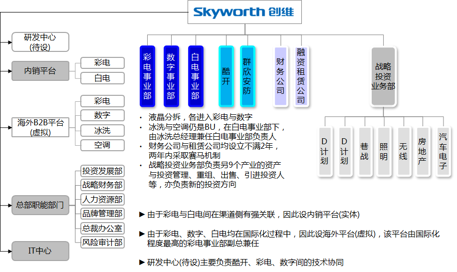

图示转写（2015年调整后架构）：

- Skyworth 创维
  - 左侧：研发中心(待设)；内销平台（彩电、白电）；海外B2B平台(虚拟)（彩电、数字、冰洗、空调）；总部职能部门（投资发展部、战略财务部、人力资源部、品牌管理部、总裁办公室、风险审计部）；IT中心
  - 右侧：彩电事业部、数字事业部、白电事业部；酷开、群欣安防；财务公司、融资租赁公司；战略投资业务部（下设 D计划、D计划、巷战、照明、无线、房地产、汽车电子 七个框）

图中要点文字：
- 液晶分拆，各进入彩电与数字
- 冰洗与空调仍是BU，在白电事业部下，由冰洗总经理兼任白电事业部负责人
- 财务公司与租赁公司均设立不满2年，两年内采取赛马机制
- 战略投资业务部负责另9个产业的资产与投资管理、重组、出售、引进投资人等，亦负责新的投资方向

底部说明：
- 由于彩电与白电间在渠道侧有强关联，因此设内销平台(实体)
- 由于彩电、数字、白电均在国际化过程中，因此设海外平台(虚拟)，该平台由国际化程度最高的彩电事业部副总兼任
- 研发中心(待设)主要负责酷开、彩电、数字间的技术协同

**对案例的思考**

- 该集团在十多年前就开始孵化多元业务，为何这么久搞了十几个产业，除主业彩电外，就只有一个产业(机顶盒)算孵化成功
- 该集团一直实行BU负责人制，即每个多元业务均作为BU、充分授权给业务负责人；为何该机制在美的集团的小家电业务发展上很成功，在该集团的多元业务孵化上不行
- 为何该集团的扁平化会在2010-2015年间导致集团领导与总部部门四处救火；为何领导分工、设委员会等做法都不起作用
- 三圈六型分类管控的本质是什么
- 委员会的领导级别比内销平台高，为何内销平台这类协同性机构能解决级别更高的委员会解决不了的问题
- 该案例与第一个案例相比，其总部部门设置有何不同

**结合XX餐饮的思考**

- XX餐饮的多元业务孵化要谋求成功，是领导分工与业务负责人制就行的吗；需要怎样的机制保障；要吸取该集团的哪些经验教训
- XX餐饮的企业间/产业间协同，哪些适合通过委员会、哪些适合通过平台型部门、哪些适合通过BU领导发挥不同作用

## 上游已确定的方案结论：组织优化总纲与落地原则

以下是本项目前序阶段已经确定的方案结论，作为本任务的既定前提，不需要重新论证，但本任务的设计必须与之一致。

本文提出组织优化的主体逻辑与核心纲领，并给出组织优化、职能优化、人员优化三类变革各自的落地方式与推进次序原则。

### 总体说明与组织现状诊断

#### 1.1 组织优化的主体逻辑

组织优化顶层设计将形成三个架构方案：1.近期目标架构(1-3年)；2.当前落地实施架构(立即)；3.远期变化架构(5年后)

**组织优化的主体逻辑**

- **针对股份公司层面组织优化**
  - **业务架构导向**：如何使组织架构超越法人架构、最大程度支撑XX餐饮在近期与未来的业务架构与战略蓝图达成
  - **适配管控模式**：怎样发挥XX餐饮集团总部、股份与酒管公司所长，形成各自合理定位有效授权与管控垂直打通
  - 贯穿集团股份酒管三层组织

- **针对酒管公司层面组织优化**
  - **借鉴领先实践**：国际酒店集团在酒店管理公司层面设哪些职能部门；如何以此推动多品牌多区域的业务发展
  - **同步人员优化**：人员问题不可干扰目标架构，但在当前落地实施方案中需考虑；人员优化匹配组织渐进调整
  - 针对组织优化落地渐进实施

#### 1.1 组织优化的核心纲领

##### 核心纲领是：打破既有组织，在组织最大程度支撑战略的前提下，实现横向权力平衡与纵向权力平衡；并通过『权责利能』的匹配，提升组织执行力

[图示] 组织优化的核心纲领（围绕"权、责、利、能"四要素展开）：

- 中心：组织优化的核心纲领
- **权力平衡**（关联要素：权力）：权力平衡的组织才具备可持续高效能作为。平衡包括横向与纵向。横向平衡指高管间与核心部门间；纵向平衡指集团、股份与酒管公司垂直层次间
- **权能匹配**（关联要素：能力）：岗位权力行使需要相匹配的人员能力。先根据新的岗位职责，选配符合能力要求的人；再根据人的到位情况，调整岗位职责，形成权与能的互动匹配
- **责利一致**（关联要素：利得）：考核与年度激励及中长期激励、特别奖罚、升职降职的挂钩，是责任与利得一致的体现。这些利得手段的综合应用对组织执行力有至关重要的影响
- **权责对等**（关联要素：责任）：岗位责任的落实体现于绩效考核指标。关键部门关键岗位的权力更大、责任亦更重，其绩效考核指标对企业价值影响更直接、指标构成也相对更复杂

注：新组织架构的落地，主要是上述权力平衡与权能匹配。责利一致与权责对等，事关绩效考核与激励，有待一两年内逐步落实到位

#### 1.5 组织落地实施方案的原则

变革分为组织优化、职能优化、人员优化三类。根据增量调整与存量调整的各自特性，形成不同的落地方式与推进先后策略。

##### 组织优化

- **增设部门岗位**（增量调整）
  例：增设COO(岗位)、增设目标管理部(部门)
  落地方式：先发布架构并虚位以待，等人员到位时付诸实践

- **合并部门岗位**（存量调整）
  例：几个部门合为品牌运营部(横向)、建人才发展中心(纵向)
  落地方式：等人员到位并启动筹备时，再发布架构

##### 职能优化

- **变更汇报关系**
  例：副总必须统管多个部门，改变汇报线
  落地方式：忌频繁变更，视时机发布/变更到位；与人员到位无关，尽早

- **变更属性**（存量调整）
  例：区域作为利润中心
  落地方式：在发布年度考核激励方案时明确；与人员到位无关，尽早

- **增设职能**（增量调整）
  例：品牌运营部增设产品研发职能
  落地方式：与人员到位无关，尽早(这样才能评判既有人员在数量/质量上是否符合职能增设后的要求)

- **移动职能**（存量调整）
  例：业主关系管理转至项目发展部
  落地方式：需考虑人员(即接收职能的部门是否有适合人员)，也可能因职能移动产生相应人员重新配置的需要；在人员问题可解决的前提下，尽早

##### 人员优化

- 编制(数量)增减
- 人员(质量)调整

**说明**：组织优化偏刚性，不宜频繁，每个优化点尽量能一步到位；职能优化偏柔性，可以渐进，每个变化点可随时进行修补。

## 上游已确定的方案结论：集团管理架构顶层设计与近期目标架构

以下同样是本项目前序阶段已经确定的方案结论，作为本任务的既定前提，不需要重新论证，但本任务的设计必须与之一致。

### 2.2 集团管理架构的顶层设计原则

#### 顶层设计原则

组织架构不受限于股权架构，要促进产业内与产业间的充分协同；以业务架构为导向；保持每一管控层的适当管理跨度与深度。

[图示]

- **股权架构**
  - 体现投资关系；主要考虑：资本市场风险控制、税务惠利政策等
    - 与组织架构重合：设实体
    - 与组织架构不重合：不设实体，只是对外披露报表的壳
- **组织架构**
  - 体现行政汇报关系，均是实体
    - 少数情况可能出现：
      - 只听汇报、不做目标/资源决策的形式组织层
      - 不设实体、只设兼管领导的虚拟管理层
- 股权架构与组织架构：可重合可不重合
- 完全呈现并能支撑其对外财务披露
  - 在不影响资本市场风险控制的前提下，向业务架构靠拢（股权架构原则）
  - 组织架构尽量调整到与管理架构一致（组织架构原则）
  - 管理架构与股权架构能在财务上对应匹配
- **财务核算/预算架构**
  - 完全呈现并能支撑其对内管理报告
- **业务架构**
  - 体现以下业务格局，是组织架构设计的起点：
    - 集团有哪些产业
    - 每个产业对集团价值/战略/品牌的重要性强弱
    - 每个产业经营单位的发展阶段(起步/成长/成熟)
    - 产业间的关联性强弱
- **管理架构**
  - 多数是实体，可以有虚拟
  - 对每个产业来说，各由哪一层对其设定目标、分配资源并管理目标的达成；保持每一个管控层适当的管理跨度与深度
  - 促进产业间的业务合作与资源共享等协同发展
- 管理架构完全支撑体现业务架构

### 2.3 组织架构不受限于股权架构

为促进产业内、产业间的各单位的协同，组织上突破股权架构有6种方式

#### 方式1：实体BU

| 做法 | 实体BU是指： 有专属职能部门(如：产品研发部门、营运部门、营销部门) 承担产业经营管控职能的管控层次 其职能包括但不限于：制定产业竞争策略、塑造产业核心能力、掌控核心业务资源、行使对各经营单位(如：单体酒店)的资源投入与目标产出管理(目标分解/跟踪/评价) |
|---|---|
| 适用 | 重要性与成熟度均高的产业 例如：XX餐饮的连锁酒店产业 |

#### 方式2：虚拟BU

| 做法 | 虚拟BU与实体BU的相同： 促进辖下经营单位的战略协同、目标协同、业务协同、资源协同 行使对辖下经营单位的资源投入与目标产出管理(目标分解/跟踪/评价) 虚拟BU与实体BU的不同： 虚拟BU只设1名专职负责人，最多再设1个工作小组，无专属职能部门，其职能落实需共用上一组织层次(如：股份公司)的职能部门 虚拟BU的职能不包括：塑造产业核心能力、掌控核心业务资源 |
|---|---|
| 适用 | 投资型BU，或成熟度不高的产业 例如：XX餐饮的多元投资业务与孵化业务 |

#### 方式3：由同一人兼任最高领导

| 做法 | 由1名高管在几个组织中兼任最高领导，通过个人作用，实现这几个组织间的战略协同、目标协同、业务协同、资源协同 |
|---|---|
| 适用 | 组织数量不能多，通常是2个组织间的协同 例如：由1名高管兼任采购中心(集采共享服务职能)、以及(与集采关系密切的)电商业务的最高领导 |

#### 方式4：目标管理与预算管理的『去法人』

| 做法 | 在目标管理与预算管理中，不按法人架构做分解，而是按管理架构做分解 非法人单位可作为目标管理与预算管理的分解/监控节点 部分法人单位不再作为目标管理与预算管理的分解/监控节点，只出统计数，无管理职能 股权架构中的5级单位、4级单位、3级单位可以打平/上移下移/改变归属方向 |
|---|---|
| 适用 | 将股权架构的层次在管理上扁平化 例如：XX餐饮的多元投资业务与孵化业务，其目标分解/预算分解只体现多元业务BU、业务类型(如：物业)这两个层次，这些业务隶属的法人单位不再作为管理节点 |

#### 方式5：委员会&联合工作组

| 做法 | 由若干高管共同组建委员会，依托委员会完成跨组织的决策、或跨组织的高层协同： 由若干部门的核心人员组建联合工作组，依托联合工作组完成跨组织工作的具体落实 |
|---|---|
| 适用 | 委员会/联合工作组最有效的作用体现于沟通 例如：沟通协调委员会、信息化建设联合工作组 由于委员会与联合工作组的人员并非专职——他们各有自己的主要身份，委员会成员/工作组成员只是他们的次要身份，所以在那些需具体落实的决策/职能/工作上，效果平平，只能作为补充手段 |

#### 方式6：由一名高管统管

| 做法 | 由1名高管(如：副总裁)统管跨组织的相关职能属性的部门，通过个人作用，确保这几个组织间的执行一致 |
|---|---|
| 适用 | 与『方式3』相似，但因为并非兼任最高领导，组织数量可以更多些 例如：酒管公司的项目拓展部、股份公司的投资发展部+证券业务部，均向股份公司主管副总汇报 |

注：需强调的是，这六种方式各有其适用场景，并非互相替代关系

### 2.4 以业务架构导向组织架构

——将集团四层组织架构打平后的当前业务架构，属2+n型架构

#### XX餐饮集团的业务版图
（黄色：既有经营产业 赭色：未来产业延伸）

##### 酒店业务
- XX餐饮饭店分公司
- 南京新XX餐饮饭店有限公司
- 南京XX餐饮酒店管理有限公司
- 湖滨饭店
- XX湖酒店
- 南京XX餐饮大厦有限公司

**经营模式**：自有酒店经营、酒店管理输出

##### 养老业务
- 江苏XX餐饮XX老年养怡股份有限公司

**经营模式**：自有养老经营、养老服务输出

##### 多元投资与孵化业务
- 江苏XX湖开发建设有限公司
- 南京XX餐饮置业发展有限公司
- 江苏XX餐饮贸易有限公司
- 江苏XX餐饮旅游发展有限公司
- XX餐饮XX物业服务有限公司
- 江苏XX糖糖酒食品有限公司

**业务领域**：旅游、糖酒/食品、地产、物业、物贸、电商、产业园规划/建设/经营、金融
（电商、以及酒店生态链上的更多孵化产业）

##### 三大业务板块特征对比

| 维度 | 酒店业务 | 养老业务 | 多元投资与孵化业务 |
|---|---|---|---|
| 经营主体状况 | 已形成多个经营体 | 单经营体 | 大多数业务是单经营体 |
| 战略价值 | 高(战略/价值/品牌) | 高(战略) | 低/中/中高 |
| 前景 | 中高(前景明确) | 低 | 低/中 |

补充说明：
- 产业园规划/建设/经营/管理：强
- 物贸电商：中-强

——集团业务架构在近期(1-3年)、中期(3-5年)的可能演进方向

#### 当前业务架构 → 近期发展

- **1. 酒店产业** → 近期发展：扩大规模、提高质量；品牌分层+多区域覆盖；提升连锁品牌影响力
- **1. 养老产业** → 近期发展：树立单体品牌；增：养老服务输出
- **n. 其他产业** → 近期发展：在增值前景好、轻资产模式的产业上发掘增量空间，如：物业；在与酒店产业关联密切、构成旅游生活生态链的产业上发掘增量空间，如：电商

#### 中远期业务架构——两种可能

第一种（延续现有产业类别继续扩展）：
- 酒店产业
  - 自有酒店经营
  - 酒店管理输出
- 养老产业
  - 自有养老经营
  - 养老服务输出
- 其他产业
  - 地产
  - 园区规划经营
  - 物业管理
  - 酒店电商
  - 糖酒食品
  - 旅游/餐饮……

（随着其他产业孵化成功，形成一两个能与酒店产业、养老产业并列的主产业）

第二种（依托于两个上市公司平台形成两大关联产业板块，每个板块内包括一个主业与若干孵化成功或孵化中的辅助业务）：
- 酒店生活板块
  - 酒店业务
    - 自有酒店经营
    - 酒店管理输出
  - 酒店电商
    - 糖酒食品
    - 旅游/餐饮……
    - 物业管理
- 养老园区板块
  - 养老产业
    - 自有养老经营
    - 养老服务输出
  - 园区产业
    - 园区开发建设
    - 园区规划经营

——近期与中远期组织架构应符合同期业务架构的特征：当前与近期2+n型、中远期有N+1型与2型两种可能

#### 当前近期：2+n型

- 2+n
  - 2个前景明确、具备规模(可多经营体、或单体)与实力、能作为战略支柱的主产业
    - 如：酒店、养老——产业间中弱关联
  - n个尚在培育初期、前景/实力/战略重要性均不明确的多元产业
    - 如：园区建设经营、地产、物业、电商

#### 中远期A：N+1型

- N+1
  - 3个以上(N个)明确将长期战略性持有、具备规模与实力、彼此强/弱关联的主产业
    - 如：酒店、养老、电商、物业——产业间中强关联
  - 1个投资孵化群，辖下若干不同阶段/规模/状态、形成组合的多元产业

#### 中远期B：2型

- 2
  - 2个已将强关联产业整合起来、下辖多个产业的主产业板块
    - 如：酒店生活板块、养老园区板块

### 2.5 管控层次及其功能定位合理化

2.5 管控层次及其功能定位合理化——根据集团业务架构，以扁平化与有效管控深度为原则，决定有几级管控层、以及每个管控层承担哪些总部管理功能

集团型企业由经营体(如：单体酒店)与管控层(如：股份公司)构成，管控层>=1层
集团有几级管控层次，主要看集团业务架构(譬如有多少产业、每个产业下有多少个经营体数量、产业的成熟度、产业间的关联性)。扁平化并不等于将管控层次减少到1层；当集团不只有一类产业时，简单将管控层次压缩为1级的做法，会导致管理跨度削弱管理深度
应以适当的管理跨度保证有效管理深度，同时厘清每个管控层的决策定位，确保每项决策在最适合的管控层决策、避免冗余的中间审核环节——这才是扁平化的关键
无论是几级管控层次，彼此间可以职能互补/对接，不可职能重叠。所有管控层的职能合集应包括以下8类：

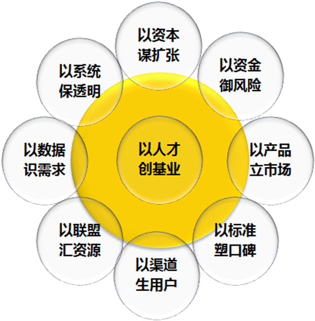
放射状圆形图（核心-辐射结构）：
- 中心：以人才创基业
- 外围八个节点（顺时针方向）：
  1. 以资本谋扩张
  2. 以资金御风险
  3. 以产品立市场
  4. 以标准塑口碑
  5. 以渠道生用户
  6. 以联盟汇资源
  7. 以数据识需求
  8. 以系统保透明

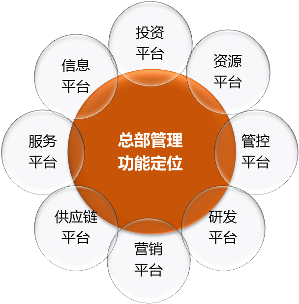
环形辐射图（中心圆+八个环绕圆）：
- 中心：总部管理功能定位
- 环绕八个圆形：
  1. 投资平台
  2. 资源平台
  3. 管控平台
  4. 研发平台
  5. 营销平台
  6. 供应链平台
  7. 服务平台
  8. 信息平台

2.5 管控层次及其功能定位合理化——根据各管控层的功能组合，有以下四类集团治理模式

#### A·单产业集团
[图示]
- 总部

2级组织架构、1级管控层
总部拥有所有8类职能

#### B·关联多元化产业集团
[图示]
- 总部
  - 业务单元

3级组织架构、2级管控层
总部拥有投资/服务/信息职能；总部与业务单元垂直对接资源/管控职能
根据产业间协同特征，总部拥有研发/营销/供应链全部或部分职能

#### C·非关联多元化产业集团
[图示]
- 总部
  - 业务单元

3级组织架构、2级管控层
总部拥有投资/服务/信息职能，强资源/管控职能
业务单元拥有研发/营销/供应链职能，弱资源/管控职能

#### D·多元产业群集团
[图示]
- 总部
  - 产业板块
    - 地产板块
    - 实业板块
    - 消费品板块
    - 金融板块
    - 能源板块
  - 业务单元

4级组织架构、3级管控层
总部拥有投资/信息职能
根据规模/能力，总部与产业板块确定服务职能归属
根据规模/协同，产业板块与业务单位确定研发/营销/供应链职能归属

D型集团是由B型或C型集团演变形成，在演变早期，保持B型/C型的治理模式，即板块为虚拟，包含在总部内，不作为单独层次
同理，B型集团、C型集团是由A型集团演变形成，在演变早期，保持A型的治理模式，即业务单元为虚拟，包含在总部内

2.5 管控层次及其功能定位合理化——无论哪种集团治理模式，关键是：一核多元、各优其能、塑造总部向心力

一核多元：总部始终在第一层引领集团方向、优化产业组合、掌控核心资源、保障整体战略价值达成
各优其能：让每一级管控层聚焦自身核心职能、因聚焦而专业、因专业而更有效地发挥作用

[图示]
- 四类集团
- 集团总部（集团套集团的多级管控层）
  - **战略进退 / 投资增值**
    - 全面掌控各产业进退互补的战略组合
    - 确保重要战略性投资的集中资源配置
    - 实现资本运作等金融手段的投资增值
- 产业组合
- 产业板块（多产业多层级、多成员、多法人）
  - 产业群1
  - 产业群2
  - 产业群3
  - **链群协同 / 平台增值**
    - 以产业群里的领先产业带动关联产业快捷发展
    - 督导各产业达成战略目标与业绩目标
    - 实现资源共享协同发展的平台增值
  - 自上而下的目标战略下达与授权
  - 自下而上的经营业绩反馈与信息
- 优势共享
- 业务单元
  - **持续领先 / 规模增值**
    - 做强产业核心竞争力
    - 实现短期与中长期绩效的持续提升与领先
    - 实现标准化体系支撑的快速复制、扩张整合的规模增值
- 体系复制
- 经营实体
  - **卓越标准 / 运作增值**
    - 融入并严格执行标准化统一体系
    - 实现低成本高效能的运作增值

底部标注：集团总部功能 | 产业板块功能 | 业务单元功能 | 经营实体功能

各级管控层各自构建其核心管理能力，因此形成四类总部：投资管控型总部、战略指导型总部、战略控制型总部、运营管控型总部

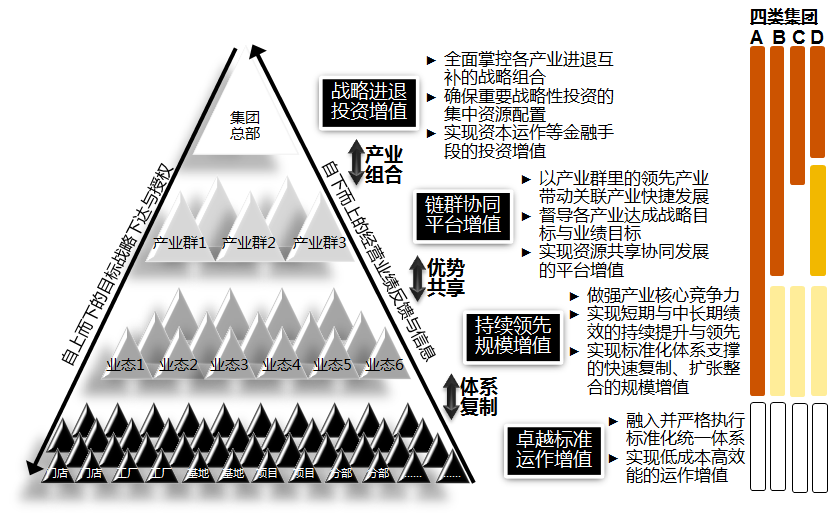

图示转写（多级管控金字塔与四类集团）：

本图无左侧层级标签，其余内容与图 2 相同。

金字塔自上而下四层：
- 塔尖：集团总部
- 第二层：产业群1、产业群2、产业群3
- 第三层：业态1至业态6
- 底层：门店、门店、工厂、工厂、基地、基地、项目、项目、分部、分部、……

金字塔左斜边：自上而下的目标战略下达与授权；右斜边：自下而上的经营业绩反馈与信息。层间双向箭头：塔尖与第二层之间「产业组合」，第二与第三层之间「优势共享」，第三层与底层之间「体系复制」。

右侧与各层对应的增值定位：
1. **战略进退投资增值**：全面掌控各产业进退互补的战略组合；确保重要战略性投资的集中资源配置；实现资本运作等金融手段的投资增值
2. **链群协同平台增值**：以产业群里的领先产业带动关联产业快捷发展；督导各产业达成战略目标与业绩目标；实现资源共享协同发展的平台增值
3. **持续领先规模增值**：做强产业核心竞争力；实现短期与中长期绩效的持续提升与领先；实现标准化体系支撑的快速复制、扩张整合的规模增值
4. **卓越标准运作增值**：融入并严格执行标准化统一体系；实现低成本高效能的运作增值

最右侧「四类集团」柱状区（A、B、C、D 四列，纵向四段与金字塔四层对应，图中无图例）：

| 段（对应层） | A | B | C | D |
| --- | --- | --- | --- | --- |
| 集团总部 | 深橙色 | 深橙色 | 深橙色 | 深橙色 |
| 产业板块 | 深橙色 | 深橙色 | 上半段深橙色、下半段空白 | 金黄色 |
| 业务单元 | 深橙色 | 浅黄色 | 浅黄色 | 浅黄色 |
| 经营实体 | 空心框 | 空心框 | 空心框 | 空心框 |

XX餐饮酒店BU、股份公司、集团整体的治理模式与管控类型

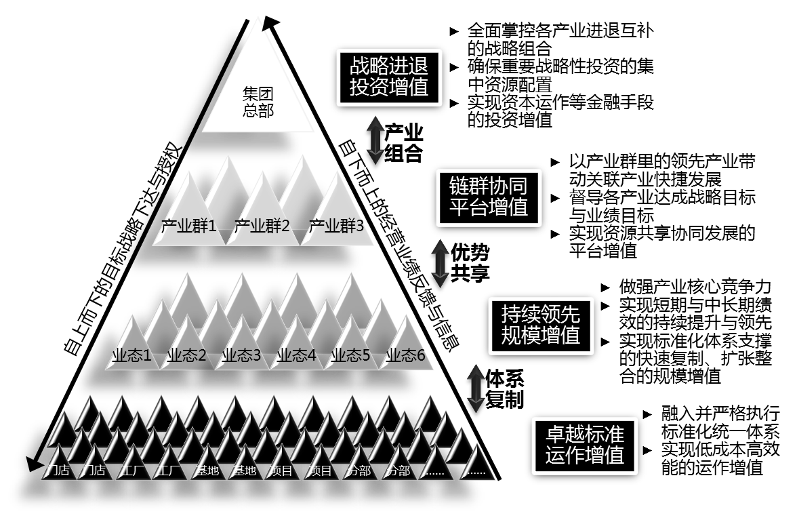

#### 管控层次金字塔结构图

**第一层：集团总部**
- 对应增值定位：战略进退投资增值
- 功能说明：
  - 全面掌控各产业进退互补的战略组合
  - 确保重要战略性投资的集中资源配置
  - 实现资本运作等金融手段的投资增值

**第二层：产业群1、产业群2、产业群3**
- 对应增值定位：链群协同平台增值
- 功能说明：
  - 以产业群里的领先产业带动关联产业快捷发展
  - 督导各产业达成战略目标与业绩目标
  - 实现资源共享协同发展的平台增值

**第三层：业态1、业态2、业态3、业态4、业态5、业态6**
- 对应增值定位：持续领先规模增值
- 功能说明：
  - 做强产业核心竞争力
  - 实现短期与中长期绩效的持续提升与领先
  - 实现标准化体系支撑的快速复制、扩张整合的规模增值

**第四层：门店、门店、工厂、工厂、基地、基地、项目、项目、分部、分部……**
- 对应增值定位：卓越标准运作增值
- 功能说明：
  - 融入并严格执行标准化统一体系
  - 实现低成本高效能的运作增值

#### 层级间关系标注（金字塔两侧双向箭头）
- 集团总部 ↔ 产业群：产业组合
- 产业群 ↔ 业态：优势共享
- 业态 ↔ 门店/工厂/基地/项目/分部：体系复制

#### 金字塔斜边文字标注
- 左侧（自上而下方向）：自上而下的目标战略下达与授权
- 右侧（自下而上方向）：自下而上的经营业绩反馈与信息

#### 集团、股份公司、酒店BU说明

**集团**
- 以酒店与养老作为两大战略性产业支柱
- 下辖股份公司与养老公司(未来上市)两个资本平台，产业间弱关联
- 属C型集团性组织、总部属投资管控型总部

**股份公司**
- 围绕旅游生活生态链(酒店/物业/电商等多个产业)构建
- 下辖多个产业，产业间中强关联
- 属B型集团性组织、总部属战略控制型总部

**酒店BU**
- 聚焦连锁酒店产业(单一产业)
- 下辖自有酒店与管理酒店
- 属A型集团性组织、总部属不完全的运营管控型总部：不完全是指只拥有产品/营销等前台职能

#### 分析说明

XX餐饮目前并没有清晰的管控层次、以及各层次清晰的管控定位。上述三层管控架构，虽对目前的XX餐饮而言有点重，但不主张合并为两层、更不主张合并为一层

XX餐饮是国资委企业，集团总部当然必须做好第1层的投资管控，尤其是对两个主产业的战略投资管控；对多元投资与孵化业务的战略投资管控职能，集团可授权给股份公司，由股份公司代行

尽管多元投资与孵化业务(n)目前尚未做大、未来也还有不确定性，但只有明确股份公司的管理对象是多个产业、而非单一酒店产业、更非单体饭店，才能使股份公司做实做强自己(作为战略控制型总部)的管理职能：多元业务的组合发展战略、投资管理、资产管理、财务/人力/IT/采购共享服务……，而不是去做酒店BU(作为运营管控型总部)该做的产业竞争策略、产品研发、市场营销、标准化体系……。若两者混淆，在百废待兴之时，恐怕两样都做不好

### 2.7 XX餐饮的近期管理架构

#### 近期管理架构

[图示]
- 南京XX餐饮饭店集团有限公司（集团总部）
  - 江苏XX餐饮XX老年养怡股份公司
  - XX餐饮饭店股份有限公司
    - 股份公司董事会
      - 沟通协调委员会
      - 战略决策委员会
      - 投资BU
      - 酒店BU
        - 南京XX餐饮饭店
        - 新XX餐饮饭店
        - 酒管公司
        - 湖滨XX餐饮饭店
        - XX湖酒店
        - XX餐饮大厦
    - 股份公司总部部门：目标管控部、投资发展部、证券业务部、风险稽查部、人才发展中心、总裁办公室、财务中心、采购中心、信息中心
  - 江苏XX湖开发建设有限公司
  - 其他集团直管的利润中心

XX餐饮的管理架构包括上述4级：L1集团、L2股份公司/养老公司、L3酒店BU/投资BU、L4南京XX餐饮饭店/新XX餐饮饭店/酒管公司/湖滨XX餐饮饭店/XX湖酒店/XX餐饮大厦/XX糖/旅游/置业/物业/电商……

#### 近期管理架构的说明：集团

| L1-集团 | 集团总部的部门 部门设置及其职能基本不做变化 集团信息管理部：只负责集团总部自身的IT建设与运维 |
|---|---|
|  | 集团总部直管的产业、及其管控模式 集团总部对酒店产业：投资管控模式 集团总部对养老产业：运营管控模式 集团总部对多元业务：授权股份公司，由后者全权代行管控职能 |
|  | 集团总部直管的企业：XX湖开发建设有限公司 为方便养老项目在XX湖的推进，XX湖开发建设有限公司由集团总部直管，直至项目完成 园区规划/建设/经营属多元业务，即2+n业务架构里的n；因此，只有在以下两种情况里，该产业隶属集团总部直管范围——目前看可能性都不大 该产业成为与酒店、养老并重的第3个战略支柱产业 未来养老业务与园区业务始终强关联发展 |
|  | 集团总部直管的企业：酒店 集团总部不再直管任何酒店，其管理关系转入股份公司下辖的酒店BU 随着管理关系转移，今后集团与股份公司间不再存在酒店产业的协同问题 |
|  | 集团直管的企业：其他公司 项目型公司：随项目终止自然终止，由集团直管，直至项目完成 非项目型公司、产业本身有发展前景：将管理关系转入股份公司 非项目型公司、产业本身无明确前景：可以仍由集团直管、也可以将管理关系转入股份公司 随着管理关系转移，今后集团与股份公司间不再存在这些『有发展前景』产业的协同问题 |

#### 近期管理架构的说明：股份公司

| L2-股份公司 | 股份公司董事会及其下设委员会：战略决策委员会 董事会是股份公司的决策机构 根据公司治理需设的其他委员会(如：审计委员会)仍保留，其职能不变 若董事会同时符合以下两项条件，战略决策委员会可以不设 董事会能保持至少每月一次(高频)的会议时间，以处理相关集体决策 董事会成员能包括形成专业决策所必需的内部、外部的资深人士 若董事会不具备以上条件，则战略决策委员会同样作为股份公司的决策机构 |
|---|---|
|  | 股份公司董事会及其下设委员会：沟通协调委员会 沟通协调委员会的作用，是解决跨BU的协同问题，例如酒店BU与投资BU、物业、电商的协同 沟通协同委员会的成员，至少包括 2个BU的负责人 BU下大的经营单位负责人 物业/电商等股份公司总部直管单位的负责人 沟通协同委员会与战略决策委员会都实行月度会议，也都可因特定事项召集临时会议 |
|  | 股份公司的总裁与副总裁 股份公司的总裁 主持整个高管团队的工作，所有股份公司副总裁均向总裁直接汇报 对集团下达给股份公司的目标总体负责 可兼任BU负责人、或直管经营单位负责人 不可兼任总部部门负责人，不可兼任非直管经营单位(如：XX糖、酒管公司)负责人 股份公司的副总裁 分管BU、直管经营单位、非直管经营单位、总部部门 分管BU的副总裁、分管重要经营单位(如：南京XX餐饮饭店)的副总裁，可以不再负责其他管理 其他副总裁原则上都不可只作为单一角色，必须是复合角色 |

#### 近期管理架构的说明：股份公司【续1】

| L2-股份公司 | 分管多个有职能相关性的总部部门，并可兼任其中一个部门的部门长，如：分管目标管控部、风险稽查部……同属于垂直管控职能的部门 分管多个经营单位，如：分管XX糖、置业 分管一个或几个总部部门、以及一个经营单位，如：分管采购中心、电商 分管一个或几个总部部门、以及一个BU，如：分管证券部、投资部、投资BU |
|---|---|
|  | 股份公司总部的部门 部门的新增、移动与职能扩充 部门新增：目标管控部、信息中心、采购中心 职能扩充：人才发展中心(原人力资源部)、投资发展部、风险稽查部(原审计部) 部门移动——转入南京XX餐饮饭店/新XX餐饮饭店：招商管理部、写字楼租赁部 部门移动——作为经营单位纳入投资BU(或由股份公司总部直管)：食品研发中心 股份公司总部的部门在组织形式上分为三类 作为平台性机构、面向整个股份公司的部门 近期：人才发展中心(集中的优才养成+培训)、信息中心(IT建设运维共享服务) 中期：采购中心(采购共享服务) 远期：财务中心(核算与结算共享服务) 执行股份公司对辖下BU/经营单位垂直管控的部门：目标管控部、风险稽查部 作为股份公司总部的专业部门：投资发展部、证券业务部、总裁办公室 股份公司总部部门负责人的汇报线：股份公司总裁与副总裁 |

#### 近期管理架构的说明：股份公司【续2】

**股份公司执行董事/总裁/副总裁分工的参考方案**

| 职位 | 职责 | 定位 |
|---|---|---|
| 董事长 | 主持股份公司全局工作 并整体负责孵化业务(每个孵化业务各有负责人) | 整体 |
| 总裁 | 酒店BU负责人 并分管人才发展中心 | 聚焦酒店 |
| 副总裁 | 投资BU负责人 并分管投资发展部+证券业务部，兼任投资发展部部门长 | 聚焦投资资产 |
| 副总裁 | 分管目标管控部+风险稽查部+信息中心，兼任目标管控部部门长 在变革初期由其分管人才发展中心，等运行稳定后再由总裁分管人才发展中心 | 聚焦变革推动 |
| 副总裁 或总裁助理 | 孵化业务(电商)负责人 并分管采购中心 | 电商采购协同 |
| 副总裁 或总裁助理 | 孵化业务(物业)负责人 并分管总裁办公室 | 物业后勤协同 |
| 副总裁 | 存续业务(XX糖、置业……)负责人 并分管财务、董办 | 聚焦存量管理 |
| 副总裁 | 核心企业(南京XX餐饮饭店……)负责人 | 聚焦企业经营 |

**L2-股份公司**

#### 目标管控部
- 股份公司总部的部门：目标管控部
- 目标管控部是XX餐饮集团战略价值垂直管控的核心载体部门
- 目标管控在集团总部的载体部门：企业管理部
- 目标管控在股份公司的载体部门：目标管控部
- 目标管控在各经营单位的载体部门：目标管控部、财务部、营运部中任一
- 上述部门形成垂直的工作指导关系
- 目标管控部的职能包括：战略管理、目标(组织绩效)管理、预算管理
  - 战略管理：在专业上辅助股份公司董事会制定中长期战略规划、年度商业计划
  - 目标管理：在专业上辅助股份公司董事会分解集团下达的目标，并做好目标跟踪监控考核
    - 集团下达股份公司整体目标、酒店产业整体目标、多元业务整体目标
    - 股份公司的目标分解是将目标分到各产业、各重点企业、各部门
  - 预算管理：辅助股份公司董事会进行年度资源配置，做好中长期预测与年度预算
- 目标管控部总经理的汇报线：向股份公司主管战略变革的副总裁(CSO)汇报

#### 投资发展部
- 股份公司总部的部门：投资发展部
- 投资发展部是行使整个股份公司投资与资产管理的专业部门
- 投资发展部的职能包括：资产管理、投资管理
  - 资产管理：在专业上辅助股份公司董事会控制存量资产的保值增值，包括酒店BU、投资BU、股份公司直管单位、股份公司总部的所有资产变更
    - 审核资产新增、处置、重组、评估等各种变更的合理性
    - 跟踪监控资产新增、处置、重组、评估的过程与结果，并提供专业意见
  - 投资管理：在专业上辅助股份公司董事会操作投资活动，实现增量资产的增值目标，包括酒店BU、投资BU、股份公司直管单位、股份公司总部的所有投资活动
    - 审核投资申请的合理性
    - 按股份公司董事会核准的产业方向，负责并购/参股等投资全过程
- 投资发展部总经理的汇报线：向股份公司主管投资资产的副总裁(CIO)汇报

**L2-股份公司**

#### 风险稽查部
- 股份公司总部的部门：风险稽查部
- 风险稽查部是保证股份公司的内外部合法合规、同时配合目标管控部行使战略价值垂直管控的部门
- 风险稽查部的职能包括：审计、监察、风险调查与建议
  - 审计：内外部各类检查/审计
  - 监察：查处个人违法违规、并损害企业利益的行为
  - 风险调查与建议：配合目标管控部发现实际偏离目标的原因与问题，识别因流程、规范、与执行导致的投资风险与经营风险
- 风险稽查部在垂直层面接受集团纪委监察部、审计部的工作指导
- 风险稽查部总经理的汇报线：向股份公司主管战略变革的副总裁(CSO)汇报

#### 人才发展中心
- 股份公司总部的部门：人才发展中心
- 人才发展中心是面向整个股份公司的培训与人才养成平台
- 人才发展中心的职能包括：培训(XX餐饮大学)、人才发展、人力资源管理
  - 培训：面向整个XX餐饮集团所有员工的培训体系建设与培训提供
  - 人才发展：面向整个股份公司所有员工的优才养成
  - 人力资源管理：面向股份公司总部与BU总部的招聘、薪酬、绩效管理
- 各经营单位(南京XX餐饮饭店、酒管公司、湖滨XX餐饮、XX糖、电商……)
  - 不再专设培训部，可在人力资源部内设培训岗，配合落实本单位的培训
  - 仍设人力资源部，负责自身的人力资源管理，包括招聘、薪酬、绩效、团队管理
- 人才发展中心总经理兼任XX餐饮大学负责人
- 人才发展中心总经理的汇报线
  - 在创建初期向主管战略变革的副总裁(CSO)汇报
  - 在运行稳定后向股份公司总裁汇报

**L2-股份公司**

#### 采购中心
- 股份公司总部的部门：采购中心
- 采购中心是整个股份公司的集中采购共享服务平台
  - 近期：以酒店BU为共享服务对象
  - 中远期：覆盖到股份公司的其他产业
- 采购中心的职能包括：采购管理、采购操作
  - 采购管理：集采品类管理、集采供应商资格管理、集采标准管理
  - 采购操作：集采物资的采购执行
- 鉴于采购中心与电商业务的高协同性，由一名股份公司副总担任电商业务负责人，同时分管采购中心(采购中心可另设部门长)
- 采购中心总经理的汇报线：向股份公司主管电商业务的副总裁汇报

#### 信息中心
- 股份公司总部的部门：信息中心
- 信息中心是面向整个股份公司的IT共享服务平台
- 信息中心的职能包括：信息化建设的规划、实施、运维
  - 规划：股份公司整体信息化规划及其更新
  - 实施：股份公司统一建设的IT系统实施
  - 运维：股份公司实施IT系统的运维
- 为保证服务的及时响应，信息中心的各级IT人员可派驻经营单位提供支持服务
  - 编制与汇报管理关系在股份公司总部
  - 具体工作地点、以及项目管理关系在经营单位
  - 例如：与酒店营销相关的IT系统实施与运维人员，派驻酒管公司，酒管公司成立系统实施项目组，派驻人员作为项目组成员，遵从项目负责人的项目管理；该派驻IT人员的汇报关系、管理关系、编制仍在股份公司
- 信息中心总经理的汇报线：向主管战略变革的副总裁(CSO)汇报

**L3-BU**

#### 投资BU
- 投资BU属虚拟BU
- 投资BU设专职领导，BU内不设部门，借力股份公司总部的部门
  - 股份公司总部部门中的投资发展部，重点支持投资BU的具体决策落实工作
  - 投资BU负责人可兼任投资发展部部门长
- 投资BU负责人的汇报线：股份公司总裁
- 投资BU负责多元业务的归口管理，包括
  - 分析各多元业务的产业整体趋势/前景/XX餐饮自身发展情况
  - 提议各多元业务的组合发展策略：规模、节奏、目标、战略上的差异与互补
  - 对各多元业务提出的资产变更与投资申请，进行专业性审核
  - 对股份公司董事会下达给每个多元业务的目标，进行落实、跟踪、纠偏的过程/结果管理
- 投资BU直管辖下经营单位，其直管单位不包括
  - 酒店BU辖下经营单位：所有酒店
  - 股份公司直管的经营单位：作为重点孵化培育的业务

#### 孵化业务(如：电商、物业)
- 重点孵化培育业务不设BU，由股份公司总部直管经营单位，不设BU的原因是
  - 孵化业务均各有业务负责人
  - 股份公司对孵化业务的战略管理、目标管理、预算管理、投资与资产管理分别由股份公司的两个部门(目标管控部、投资发展部)遵循董事会决策行使，这两个部门也各有分管副总裁，完全可以起到对孵化业务的有效管理作用
  - 重点孵化培育业务做得好，可能上升为独立的BU(就像酒店BU那样)；做得不好，则可能将管理关系转入投资BU作为存续业务管理；若设孵化BU，进退都不容易处理
- 未来若重点孵化培育业务的数量增加到>5种产业，再单设BU
- 未来若不再作为重点孵化培育业务，将管理关系转入投资BU
- 各孵化业务的业务负责人向股份公司总裁汇报

**L3-BU**

#### 酒店BU
- 酒店BU属实体BU
- 酒店BU设专职领导，短期内先借力酒管公司的部门
  - 等有合适人员时(2年内)，由新的高管担任酒店BU负责人兼任酒管公司总裁，这样酒管公司的职能部门就等于是酒店BU的职能部门，酒管公司与酒店BU完全合体——届时股份公司总裁可不再兼任酒店BU负责人
- 酒店BU直管辖下经营单位，包括
  - 所有自有酒店
  - 所有委托管理、特许经营的酒店
  - 所有合资控股的酒店
  - 所有XX餐饮参与或不参与具体经营的参股酒店
- 酒店BU的功能
  - 基本等于酒管公司——这也是为何需在适当时将酒店BU与酒管公司合体的原因
  - 在未合体前，酒店BU的目标分解/落实/跟踪/纠偏工作
    - 由酒店BU委托股份公司的目标管控部统筹
    - 自有酒店、合资控股酒店、参股酒店：由股份公司的目标管控部负责
    - 委托管理酒店、特许经营酒店：由酒管公司的目标管控部负责
  - 在合体后，上述工作均由酒店BU(即酒管公司)的目标管控部负责
  - 酒店BU下各酒店的投资活动与资产变更，由股份公司投资发展部门负责专业审核，由股份公司董事会决策
- 酒店BU下设经营协同委员会
  - 由酒店BU领导、南京XX餐饮饭店/新XX餐饮饭店/湖滨酒店/酒管公司等单位的主要负责人(总裁与副总裁)……组成
  - 以解决酒店BU内的跨单位协同问题，尤其是涉及到高层协同的问题
  - 酒管公司的职能部门同样有协同职能，如：酒管公司营销活动推广到自有酒店、自有酒店客户资源共享到酒管公司。在酒店BU与酒管公司未合体前，这类协同可能会出现一些困难需由经营协同委员会解决，等合体后，应该主要由职能部门负责此类协同
